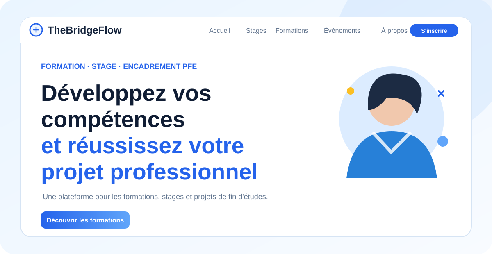
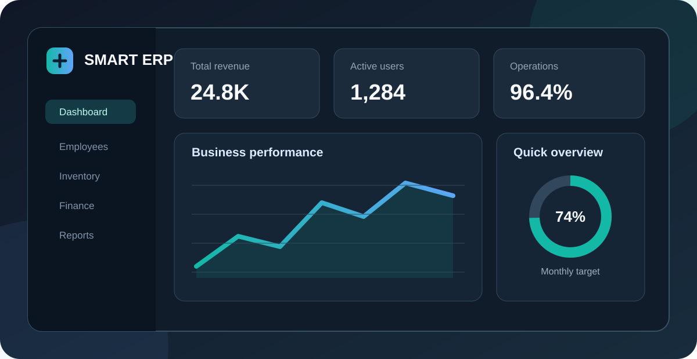
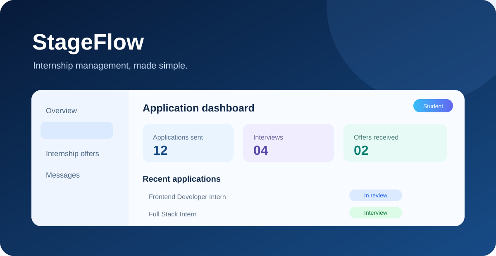
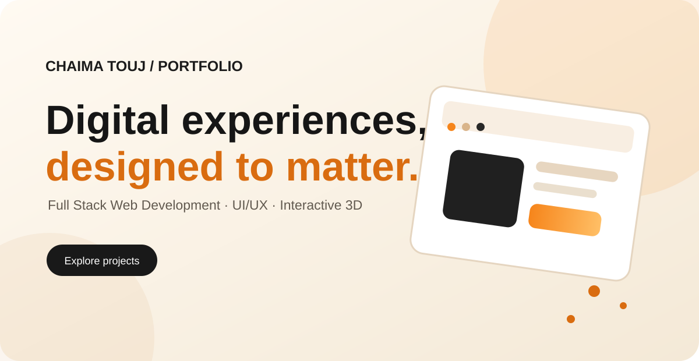
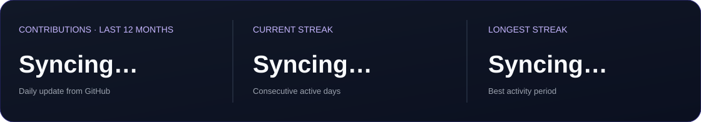
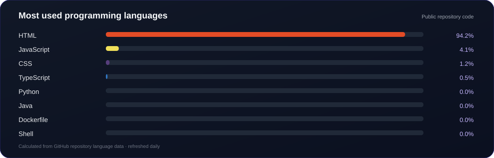
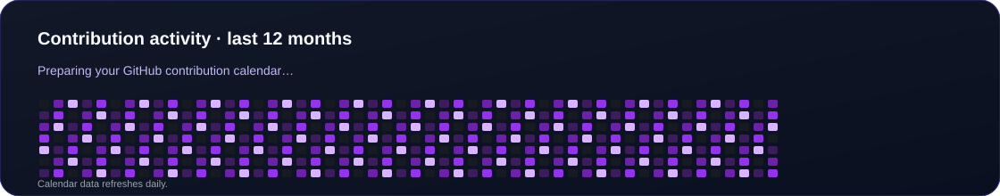

<!-- PROFILE HEADER -->

  

  
  
  
  

---

## About Me

I'm **Chaima Touj**, a Junior Full Stack Web Developer from Tunisia, passionate about building modern web applications that combine clean interfaces, useful features and reliable back-end architecture.

- Graduate in **BTS Informatique de Gestion — Development**, IMSET.
- **Top of my graduating class**, with an overall average of **18.65/20**.
- Hands-on experience building full-stack applications with the **MERN stack**.
- Interested in UI/UX, REST API development, database design and turning real needs into practical digital products.

I enjoy working across the full development cycle — from understanding an idea and designing the interface to building APIs, connecting databases and delivering a working application.

---

## Tech Stack

### Frontend

  

### Backend & Databases

  

### Programming Languages

  

### Tools & Design

  

---

## Featured Projects

<table>
  <tr>
    <td width="50%" valign="top">
      
      <h3>TheBridgeFlow</h3>
      
A full-stack platform for training, internships, PFE applications, interviews, messaging and AI-assisted student support.

      
<a href="https://github.com/Chaima-Touj/TheBridgeFlow">View repository →</a>

    </td>
    <td width="50%" valign="top">
      
      <h3>Smart ERP</h3>
      
A business management project designed to organize workflows, company information and operational activities.

      
<a href="https://github.com/Chaima-Touj/Smart-ERP">View repository →</a>

    </td>
  </tr>
  <tr>
    <td width="50%" valign="top">
      
      <h3>StageFlow</h3>
      
An internship-management web application for students, companies and administrators, with offers, applications and tracking.

      
<a href="https://github.com/Chaima-Touj/stageflow">View repository →</a>

    </td>
    <td width="50%" valign="top">
      
      <h3>Personal Portfolio</h3>
      
A modern React portfolio featuring interactive 3D visuals, project showcases, skills, experience and contact sections.

      
<a href="https://github.com/Chaima-Touj/Portfolio">View repository →</a>

    </td>
  </tr>
</table>

### More work from my portfolio

Explore concepts such as **Crystal Rent Car**, **Star Box Events**, **AMY Porte**, **Amelia Voyages**, **See You Store** and other business websites.

[Explore my Portfolio repository →](https://github.com/Chaima-Touj/Portfolio)

---

## Professional Experience

### Full Stack Web Developer Intern — BeeCoders
**June 2026 – August 2026**

- Worked on a custom web platform using the MERN stack.
- Contributed to front-end and back-end development with React and Node.js.
- Took part in building a practical solution designed for real-world use.

---

## GitHub Analytics

  

  

## Contribution Graph

  

---

## Let's Connect

I'm always interested in meaningful projects, collaboration and opportunities to build useful digital products.

  
  

  <i>Building thoughtful experiences, one project at a time.</i>

  

